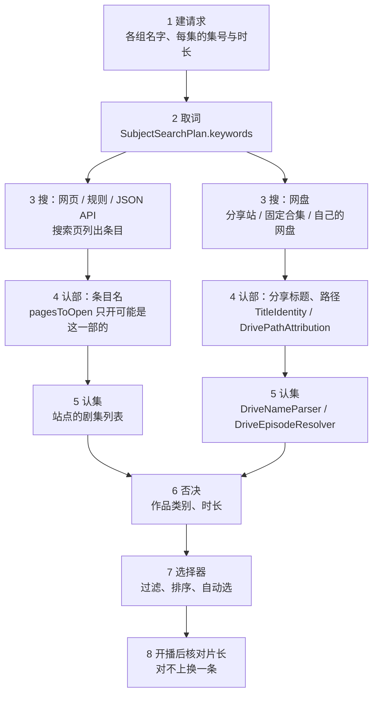

# 数据源搜索

网页（`SelectorMediaSource`）、规则（`RuleMediaSource`）、JSON API（`JsonApiMediaSource`）、直连 API 与网盘（自己的网盘、分享搜索、播放线索）
从「一个条目」找到「它的资源」走同一套步骤，各源只换与站点打交道的那部分。BT 源按发布标题搜，选择器不核对 BT 资源的名字，
另见[BT 源查续作](media-source.md#bt-源查续作)。数据源本身的配置与协议见 [MediaSource](media-source.md)，选择器见 [MediaSelector](media-selector.md)。

难处几乎都在名字上：站点、分享、文件夹的写法五花八门；同一个名字可能是好几部作品（同系列的各季、重制版、同名的真人剧）；
短名字又常是别的作品名字的一段。整套步骤按三条原则：

- **名字相等才算点名某一部**。一段名字含着本条目的名字不等于写的是本条目（「一杆青空」不是 AIR，「怪物事变」不是怪物）。
- **认得出的别的作品就是别的作品**。同系列的按系列关系图认，系列以外的按全部动画的名字表认。
- **拿不准的交给后面的证据**（季、集号、年份、时长），不靠「没有反证就当是」。

## 总览

| 步骤 | 做什么 | 主要代码 |
|---|---|---|
| 1 | 建请求：本条目的各组名字、每一集的集号与时长 | `MediaFetchRequest.create`、`fetchNameHintsOf`、`withRegionalNames` |
| 2 | 取词：每个源搜哪些词、按什么顺序 | `SubjectSearchPlan.keywords` |
| 3 | 搜：站点的条目页、分享、网盘文件 | 各数据源 |
| 4 | 认部：搜到的条目名、分享标题、路径点名的是不是这一部 | `TitleIdentity`（名字表 `AnimeNameIndex`），网页另有 `SelectorNameRules` |
| 5 | 认集 | 网页 `WebSearchEpisodeMatching`；网盘 `DriveSubjectSeason`、`DriveNameParser`、`DriveEpisodeResolver` |
| 6 | 否决：作品类别、时长 | `NotAnimeMarkers`、`WorkKinds`、`EpisodeDurations` |
| 7 | 过滤、排序、自动选 | [MediaSelector](media-selector.md) |
| 8 | 开播后核对片长 | `EpisodeDurationMismatch` |

共用的代码在 `app/shared/app-data/.../domain/mediasource/search`，网盘的路径与集号在 `.../clouddrive`，索引见[代码地图](media-code-map.md)。

## 名字从哪来

### 请求里的名字

`MediaFetchRequest` 带着几组用途不同的名字：

| 名字 | 来源 | 用来 |
|---|---|---|
| 搜索名 `subjectNames` | 条目名，用户能改 | 搜；也算本条目的名字 |
| 认部的名字 `nameHints.ownNames` | 条目服务上的全部名字、港台译名、系列关系推出的「系列名 第N季」 | 认部（用户改了搜索名，这一部还是这一部） |
| 系列名 `nameHints.seriesNames` | 同系列别的作品里被本条目名字包含的，长的在前（「死神」之于「死神 千年血战篇」） | 搜整个系列；谁也不点名（整个系列的合集常拿它起名） |
| 同系列别的作品 `nameHints.otherWorkNames` | 系列关系 | 认出别的部 |
| 回退关键词 `fallbackSearchKeywords` | 带季号的别名、系列关系推出的基础名、一个港台译名 | 只搜，不认部（基础名同时是第一季的名字，拿来认部会放过第一季的资源） |

搜索计划认部用「搜索名 + 认部的名字」（`SubjectSearchPlan.ownNames`）。`nameHints.splitSeason` 说这一部是不是拆分季的一段。

港台译名（`RegionalSubjectNames`）来自 TMDB 对应表（bangumi-tmdb-map）的 `names` 列。TMDB 的剧集按系列登记，译名是系列名，所以按条目名字里的季号补上
（「藥師少女的獨語 第二季」）；只给一个、排在回退关键词最后：排在系列名前面的话，简体站会先用台湾的系列名命中第一季。
认部的名字带上港台的本季与别季名字，繁体页面也认得出；选择器那边同样把港台译名作为条目别名、把别季的港台名字加进系列信息（见[选源](media-selector.md#过滤规则列表)）。

每一集（`episodes`）带条目内序号 `sort`、系列连续序号 `ep`、播出日期与 Bangumi 记的时长（`durationSeconds`，存在分集收藏表里）。

### 名字表

认部要知道「这个名字是哪部作品」。`SeriesGraphTableRepository` 从 bangumi-sequel-seasons 下一张表（`SeriesGraphTable`，原文常驻内存，查到哪行拆哪行）：

- 优先下**全部动画的表** `bgm-anime.tsv`（表头 `# bangumi-anime v1`，三万多部；列是条目 id、原名、中文名、首播日、本篇集数、类型、前传、续集等，最后一列是别名）；
- 取不到时下只有前传或续集的 `bgm-series-graph.tsv`；已经是全部动画的表时不换成后者。

系列走法、续作换季、系列名只看前传续集两列，两张表答得一样；系列以外的作品只有全部动画的表认得。

- `AnimeNameIndex`：建在表上的名字索引（名字哈希 → 条目 id，十多万个名字不到 1 MB，同一张表只建一次）。键是小写、只留字母数字，
  不做繁简转换（安卓上十多万个名字转一遍要好几秒），查的时候原样与转成简体各查一次。
- 网盘认部经 `TitleIdentities` 拿表；网页类数据源的请求要能序列化、带不了表，从 `AnimeNames` 取（app 启动时接到 `SeriesGraphTableRepository.loaded`）。

表有三种状态，只有用得着表的那几条跟着退：

| 状态 | 网页的条目名 | 网盘 |
|---|---|---|
| 全部动画的表 | 全用 | 全用 |
| 只有系列关系图（下不到全部动画的表） | 系列以外的作品认不出（规则 4） | 系列以外的作品与同名的别的版本认不出（规则 4、5 的第一条），其余照用 |
| 还没读进来（刚装好、下载失败又没有存着的表） | 只按名字认：短名字要单独成词照查 | 分享站的标题与路径都不查，认季只按条目名写的季与 TMDB 对应表 |

网盘的路径与认季离不开系列关系图（前传、拆分季、是不是后来的作品），没有表时不拿名字凑；只按名字查分享标题也不做：
拦下的分享让位给排在后面的，打开后路径又不查，按集号配上的错的反而更多。

### 名字的写法

- `TitleForms`：比较写法 `compact`（转简体、小写、只留字母数字）、主标题 `mainTitle`（去掉季号与副标题）、去装饰符号、去中日文之间的空格；
  `isDistinctive`：够不够长（汉字至少 3 个、纯英文数字至少 5 个），不够长的是**短名字**。
- `TitleParts`：一段名字（页名、分享标题、文件夹名、文件名）里写的作品名：
  - 去掉年份、季、集数与范围、画质编码、字幕语言、合集词、分类词、字幕组与推广文案（「资源名称：」、「亮点：」之后的介绍、话题标签）；
  - 括号里的、隔着空格换了文字的（英文 / 有假名的 / 只有汉字的）、用 `+ & ＋ ＆` 或两边带空格的 `/` 连着的各算一个。
  
  拆不干净的会留下多余的字，那就与谁都不相等：按相等比的地方只会少认，不会认错。

## 取词

各源搜什么词都取自同一份搜索计划（`SubjectSearchPlan`），各源只按自己的写法（`KeywordStyle`：只取首词、去特殊字符、用几个名字）改写。
每个词带着它从哪来（`KeywordKind`：条目名、同一个名字的另外写法、别的叫法、系列名、副标题），数据源按它决定搜到的东西怎么认。

**网页类站点**（`SubjectSearchPlan.keywords`，链是共用的 `keywordSearchChain`）：

- 先用 `autoMatch.searchUseSubjectNamesCount` 个条目名各搜一次；都没搜到这一部时依次试回退关键词，搜到为止。
  搜到这一部（`foundOwn`）按结果算：`identify` 认为是这一部的条目页产出了资源；只搜到别的作品、或这一部的页一条资源也没有的不算。回退关键词有：
  请求的回退关键词、被系列名换下的名字自己的首词、名字去掉中日文之间空格的写法（「继 怪怪守护神」搜不到「继怪怪守护神」）。
- 改写后相同的词只搜一次，截成太弱的词（一个字、很短的英文）的回退不搜。
- 只取首词的源本来就是想搜整个系列：名字里含系列名时取系列名的首词（「继 怪怪守护神」的首词「继」什么都搜得到），没有系列名而首词太弱时用整个名字。
- 回退只在前面都失败时发起，本来搜得到的条目不多发请求。

**按标题原样找的站点**（网盘的分享站、固定合集、自己网盘的按名字搜，`KeywordStyle.literal`）：站点拿整段字符串比标题，名字里的季号与副标题常与分享上的写法不一样，所以

- 主关键词是各名字的主标题；回退关键词依次是主标题的另外写法（去装饰符号、去中日文之间的空格，原样搜不到时紧接着试）、副标题（`DriveSeriesParts`）、
  系列名与港台译名；够长的才搜。
- 分享站一个名字原样搜不到时先试它的写法，再轮到下一个名字；认出的剧集覆盖了条目已播出的每一集就不再换名字（这类站连着搜几次就会回 5xx），
  搜到了分享却一集都没认出（都是别的作品、别的季）、或只认出其中几集（一个分享只收了一段）时换下一个名字；
  换完名字还没覆盖每一集时，再依次搜第一个副标题、最长的系列名、其余副标题与别的叫法，共三次，覆盖了就停。
  站点本身连着两次出错（5xx、连不上、连接被重置）就不再换词：换了词也连不上，每次还要白等搜索间隔与超时；中间回过一次就重新数。

**缓存与记忆**：

- 搜索缓存同时是关键词链的记忆：缓存行按关键词写入，只有搜到过条目页的词才有行；下次把有行的词排到最前，它们搜到了就不再碰其余的。
  有行只说明搜到过条目页、不说明名字对上了，所以记忆只决定顺序，不参与判定。
- 从搜索缓存读回结果时，读回的每一页都要用得上：页面的剧集列表里有已上映的最新一集，或者只查当前这一集、页面里有这一集。
  有一页用不上（页面可能已经更新）就整个重搜，不跳过它只用别的页：同一个词第二次查不能比第一次少。
- 每开完一个条目页就写进缓存，这个词要开的页都开成了才把这一轮标成完整（`roundComplete`）。读到没开完的一轮（选定后搜索被暂停、有页出错）时，
  先交出缓存里的，同时照常重搜补齐；完整的一轮才直接用缓存、不再搜。
- 读回的条目页按页名重新认部（`SubjectSearchPlan.identify`），不是这一部的不用，与在线搜时不打开它一样；网页、规则与 JSON API 都这样读缓存。
- 站点回应另有一份跨条目共用的内存记忆（`SiteSearchMemory`）：同系列各季多拿同一个系列名搜，换一季时搜索结果与条目页是同一份；
  搜索结果最多记 10 分钟，条目页记满搜索缓存的有效期、取出时还要含已上映的最新一集。

## 搜

- **网页、规则、JSON API**：搜索页列出条目，只打开可能是这一部的（`SubjectSearchPlan.pagesToOpen`：是的在前，说不准的随后，不是的不开），条目页列出线路与各集。
  取首词搜出的一大片无关条目不必每个都发一次请求。
- **直连 API**：配置了校验的按 Bangumi 条目 id 在站点上校验候选（`DirectApiEngine`），名字只拿来搜；没配置的信搜索结果的第一条。
- **网盘**：
  - 分享站每个词搜到的分享先按标题认部（见下），再按标题写的季排先后：写了本季的在前、没写季的居中、只写了别的季的最后；打开前 `maxShares` 个，打开过的不再打开。
    只排序不去掉，因为写着「第二季」的分享里常连第一季一起放。
  - 列文件夹时跳过按季分好的一层里别季的文件夹。
  - 外挂音轨、字幕（`.mka`、`.flac`、`.ass` 等）网盘的类别字段说是视频也不算视频。

## 调度

一次开播几十个数据源一起查，选择器等它们交结果；弱机上它们与选源、播放抢 CPU、网络与内存（`MediaSourceMediaFetcher`）。

- **开查的先后**（`SourceStartOrder`）：本地缓存最先；其余按选源时这个源能到的最好层级（线路层级、画像降级都算上，`startTierOf`），
  同层在线源在 BT 前，再按真实播放的成败与画像估的用时。只按源自报的层级的话，自报 T4、线路有 T1 的源要排在所有 T1~T3 后面，常常还没轮到就被暂停。
- **同时查几个**（`MediaSourceSearchLimiter`）：上限是设置「同时搜索的数据源」（`MediaSelectorSettings.searchConcurrency`，默认不限）。
  吃不消时（查的时候系统内存告警、开搜时系统已报内存低、搜索把播放拖卡、上次开搜时在前台被系统杀掉）按阶梯往下调一级，写回设置并经
  `SettingAdjustments` 告知（`SearchConcurrency`、`AndroidSearchConcurrency`）。名额按开查的先后发；名额空着时同时来的一批先收齐一会儿再发，
  免得头几个名额归列表里排在前面的源。占着名额太久的源把名额让给下一个、自己照常查完，让过名额还在查的也算数，真正在查的不超过上限的两倍。
- **线程**（`SearchDispatchers`）：数据源的查询跑在低优先级的线程上，每个源一条通道，同一组线程先给开查先后里靠前的源（`PrioritySearchPool`）；
  起步交空结果、发布状态与结果排在所有源的查询前面，选择器要等每个源都交过一次才开始判断。
- **交结果**：网页、规则、JSON API 开完一个条目页、网盘分享搜索开完一个分享就交一批（`BatchedSizedSource`），同一页的资源一起到选择器，
  不会先只看到一页的第一条就选。网页抓取源一个词搜到几个条目页时同时开两页（同规则源）。
- **选定就暂停**：自动选定资源时就暂停还没查完的源，不等视频播起来（`PauseMediaFetchWhilePlayingExtension`，见 [MediaSelector](media-selector.md)）。
- 这些的开关与参数在 `DevSwitches` 里，默认是真机上量过选定的取值。

**诊断**：调试开关「开播诊断」（`DevSwitches.playDiagnostics`）开着时记开播时间线（`PlayTimeline`，控制台 `api/debug/timeline`：
查询会话、各源排队与开查、认部、开页、自动选源每一步、解析、交给播放器），自动选源每一步在等什么（`AutoSelectTrace`），
共用客户端与播放请求的各段耗时（`HttpPhaseLog`、`PlaybackRequestLog`），以及主线程卡住时的栈（重启后生效）；关着时都不记。

## 认部

一段名字点名了哪一部由 `TitleIdentity` 判：这一部（OWN）、别的部（OTHER）、几部都有（SEVERAL，说不清）、哪一部都没点名（NONE）。

### 名字怎么算出现

名字按比较写法比。够长的名字含在一段名字里就算出现；**短名字**（「AIR」「怪物」「娜娜」）要单独成词才算（`TitleOccurrences.standsAlone`）：

- 前后挨着字母汉字的不算：「一杆青空」「怪物事变」「谷江玲音」「Fairy」；
- 后面接着「：」副标题或标题另一段英文的不算：「怪物：丽兹·波顿的故事」「AIR GEAR」；
- 挨着数字、季集与合集标记、类别标记、本条目别的名字的算：「2004怪物」「虫师第一季」「日漫间谍过家家」「NANA娜娜」；
- 汉字写的名字挨着英文字母算；英文写的名字挨着汉字不算（中文标题里常夹着英文词：「杀死Air」）。

### 规则

1. **同系列别的作品**：`otherWorkNames`（系列关系图里名字以本条目主标题开头、有前传或续集的作品，与顺着前传续集走得到的作品）的名字出现了是别的部。
   一段名字里同时有几部的名字时按出现的位置算：本条目的名字每一处都落在别的作品更长的名字里的不算点名这一部（「机动战士高达SEED」是 SEED），
   有一处单独写着的照算（「机动战士高达 TV版 + 机动战士高达SEED」两部都有，说不清）；别的作品的名字不比出现了的本条目名字长的不算（「XX 第三季 (附第二季)」是第三季）。
   本条目名字里含着的系列名谁也不点名。
2. **第一部的名字接着别的标题**：系列的第一部（名字就是系列名）的名字每一处后面都紧接着标题的另一段英文的，是同系列别的作品
   （「Sword Art Online Alicization」「刀剑神域 Extra Edition」，`TitleOccurrences.continuesEvery`）。系列关系图只有别的作品的中文名与原名，
   这类英文写法靠它认；格式标记、本条目英文名里的词不算，写着季的按季认。
3. **副标题**（`DriveSeriesParts`）：「系列名 + 副标题」的条目与系列里后来的作品，只有这一部的副标题是这一部，只有别的部的是别的部，都有的说不清。
4. **认得的别的作品**（`KnownWorks`）：`TitleParts` 拆出的作品名正是名字表里另一部动画的名字时，那一段写的是那一部。
   拆出的作品名与原样的写法（不去季号、不按文字切开，`TitleParts.wholeNamesIn`）都比：名字本身带着季或几种文字的
   （「BanG Dream! 2nd Season」「BanG Dream! ガルパ☆ピコ」）拆开后与谁都不相等。
   - 「新海诚合集 / 秒速五厘米」之于言叶之庭；
   - 本条目的名字只出现在那个名字里的也是那一部：「Re：从零开始的异世界生活 新编集版」；
   - 同时写着本条目、系列名的是几部的合集，说不清：「咒术回战1-2季全+紫罗兰永恒花园全集」；
   - 本条目与同系列的作品也叫这个名字的不算（表里的别名，桌面与 iOS 不做繁简转换时的繁体写法）：同系列的按 1、3 认。
5. **年份**：
   - 同名的别的版本（旧版、重制）只能按年份分，从文件往外第一个写着本条目或那一版开播那年的一层说了算（「Kanon [2002] / [ReinForce] Kanon 06.mkv」之于 2006 年版）；
   - 系列的第一部：点名这一部而写的年份都与开播年份差一年以上的是别的作品（「红辣椒俱乐部 (2019)」之于 2006 年的红辣椒；写着重制、修复的除外）；
     路径上点名这一部的那一层没写年份时，看外层第一个点名这一部又写了年份的（「怪物 / G 怪物 2024 / 怪物.E01.mp4」之于 2004 年的动画）；
   - 系列的第一部：没点名哪一部、写的年份是同系列别部开播那年的文件夹是那一部（「04 初吻不会结束（2023）全4集」）；
   - 续作不看年份：整部的合集常按第一季的年份写。上传更新的日期（「2025-04-02」）与发行年份（「2023 BDRip」）不算年份。

### 各处用哪几条

| 规则 | 网盘：分享站的标题 | 网盘：视频的路径 | 网页：条目名 |
|---|---|---|---|
| 1 同系列别的作品 | ✓ | ✓ | 按 `SelectorNameRules`（见下） |
| 2 第一部的名字接着别的标题 | ✓ | ✓ | |
| 3 副标题 | ✓ | ✓ | |
| 短名字要单独成词 | ✓ | ✓ | ✓ |
| 4 认得的别的作品 | ✓ | ✓ | ✓ |
| 5 年份 | ✓ | ✓ | 不用（站点标的年份常不对：「【2000新番】真实之泪」） |
| 按短名字搜到的要点名这一部 | ✓ | | |
| 不是动画（见[否决](#否决)） | 短剧 | ✓ | ✓ |
| 剧场版、外传、OVA（见[否决](#否决)） | | ✓ | ✓（本篇的集，在选择器里） |

**网页的条目名**（`SubjectSearchPlan.identify`；`pagesToOpen` 按它开页，`foundOwn` 按它决定关键词链停不停）：

- 先问名字表（`TitleIdentity.rejectsPageTitle`）：名字是系列以外认得的别的作品（「怪物转生」「WWW.迷糊餐厅」），或只含着本条目的短名字而没单独成词
  （「忧郁的物怪庵」之于物怪）的不是。
- 其余按 `SelectorNameRules` 判，与选择器过滤 WEB 资源的名字规则相同：与本条目某个名字相同的是；正是本条目去掉季号的系列名、而本条目按系列内序号编集时说不准
  （站点把整个系列放在一页）；季号是别的季、或与同系列别的作品同名的不是；剩下的名字对得上才是；拆分季的一段不判别季（站点常把几段放在一页）。
- 所以 `identify` 认为是这一部的，选择器不会以名字不符或别季为由排除，链也不会停在只搜到第一季的那次。被名字表否掉的页不开，也就没有资源。
  选择器不用名字表：开了的页都过了上面的判断，不开页的直连 API 能校验时按 Bangumi 条目 id 认，在它上面加名字规则只会多丢。

**网盘**：自动按名字找的地方都查（分享站的标题、固定合集的文件夹、分享与自己网盘里的视频、播放线索里的文件夹）；
用户添加的分享、手挑的文件夹是用户指定给这个条目的，不查。

- **分享站的标题**（`TitleIdentity.rejectsTitle`）：点名别的部、系列的第一部写着别的年份、写明是短剧的不打开；按短名字搜到的，标题还得点名这一部（「杀死Air（91集）」不开）。
- **视频的路径**（`DrivePathAttribution`）：从文件往上（文件名、各层文件夹、分享标题）第一个点名了某一部的那一层说了算。
  - 名字没点名时看写的季与段：只写了本季的是这一部；拆分季写着几段共有的季或季名、又写了第几段的，本段是这一部、别的段是别的部。
  - 季号只在认定的这个系列里算数：
    - 名字点名的是系列的第一部、又写着本季（第 2 季及以后）的算这一部：后几季常拿第一季的名字加季起名（「弦音 -风舞高中弓道部- 第二季」）；
      点名系列以外认得的作品、同系列别的季与剧场版、别的部的副标题的，写了本季也是那一部（`TitleIdentity.seasonCanOverride`）；
    - 只写了季与段的一层，往外第一个点名了某一部的名字是系列以外认得的作品时，是那一部（「间谍过家家 第二季 / S02E01.mkv」之于别的番的第二季）。
  - 点名这一部的那一层与文件之间隔着另一套编号的文件夹时那个名字不算（说不清）：写了别的季、拆分季共有的季、本条目集号以外的集号范围（「1-40」），
    或写着同系列别的作品的年份（「吊带袜天使 (2010)」）。这类分享按最新一部起名，里面附着前几部。
  - 点名别的部的视频不要；播放线索里的文件夹是别的作品时线索作废、照常搜。

## 认集

**网页**：站点的剧集列表给集号或集名（`WebSearchEpisodeMatching`）。站点给不出集号、名称也不是只标了画质与语言时：

- 整个条目页只有这一条、条目又不是多集的番时，它是整部作品，记第 1 集；
- 名称与正在看的这一集的名字相符时认作这一集；
- 多集的番里没写集号、只标了画质语言的一条（同名的剧场版、真人电影或整季合集）不认作哪一集。

集号与季的匹配（`sort` 与 `ep`、拆分季的季内序号）见[选源](media-selector.md#为什么要考虑两种序号)。

**网盘**：

1. **条目按第几季找**（`DriveSubjectSeason`，只有一份）：条目名写明的季从严（中文名或原名写了的按它；都没写时别名写的季只有一个才算，系列关系图里有前传时才看别名）；
   名字没写时推出来的只去掉写明别季的，推的来源依次是 TMDB 对应表与系列关系图（`seriesSeasonOf`）；都推不出时系列的第一部当第一季。
2. **文件名里的集号**（`DriveNameParser`）：先去掉编码与声道（「H.265」「×265」「DDP5.1」）和本条目名字里的数字（「秒速5厘米」「5 Centimeters per Second」）。
   `S01E03`、`第3集`、`EP03`、发布组的 `[03]` 与 ` - 03` 写在集号的位置上；名字里只剩一个数字时也当集号，
   但只有一集的条目、文件夹里只有这一个视频时不算（「酷漫404」）。
3. **取证据**（`DriveEpisodeResolver`），第一种对得上的说了算：
   - 对应表对上的 `S几E几`（TMDB 把后来的作品单列成一部、S1E1 起时，路径点名了这一部才查表）；
   - 拆分季按共有的季编的集号落在本段里的；
   - 系列里后来的作品、路径说不清是不是这一部时，只认这一部的跨部连续集号（离文件最近、提到这个系列的那一层点的是系列名，而不是集号与本条目重叠的作品；
     集号也是本季序号时还要所在文件夹里有只能是连续编号的集号），别的不要；
   - 其余按季的规则认：条目名写明是第 N 季时不写季的文件只认系列绝对集号，推出来的季不写季的照留；网盘把系列里的一段当成单独一部、从这一段起编季的，
     路径点名了这一部、集号又正是系列连续集号时照集号认。

## 否决

- **作品类别**：
  - 真人版、真人剧、日剧日影、年份电影（只认括号里的标签，标题本身可能含着这些字）与短剧（`NotAnimeMarkers`）不是这一部，条目自己就是的除外；
    网页的条目名、网盘的路径都查；分享站标题写着短剧的不打开（「短剧更新汇总」列着几十部短剧，条目名常是其中一部名字的一段）。
  - 剧场版、外传、OVA（`WorkKinds`，网盘与网页共用）：写明是这一类而条目不是的不要。条目自己的类别是名字里写着的，加上 Bangumi 记的类型
    （名字表、系列关系图的「类型」列，`WorkKinds.ofCategory`：「FLCL」名字里不写，它本身是 OVA）；条目本身是 OVA 时，网盘文件名里的 OVA 标记
    也不当「附带的番外」（「[OVA] FLCL 03」是正片）；
    「TV+剧场版」「1-4季」这类合集名写着的不算，只有一集的条目不查；短剧连合集名写着也不要。字间插了竖线的（「海丨贼丨王丨真丨人丨版」）去掉竖线再认。
    网盘查路径上的文件夹与文件；网页在选择器里查条目页名（`WebWorkKindCheck`），只在要的是本篇的集时查：
    「XX OVA」页上的第 01 集按集号会对上本篇第 1 集，而特别篇的集常就在这种页上，所以页照开。
- **时长**：网盘列目录给了视频时长时，认出是哪一集之后与这一集的时长差太多的（不到四成或超过两倍半：短剧、同名的剧场版）不要（`EpisodeDurations`）；
  时长不知道的照旧，用户手挑的文件夹不查。网页的资源开播才知道片长，见[开播后核对片长](#开播后核对片长)。

## 交给选择器

数据源返回条目的全部资源，按当前一集筛选、排序与自动选择都在选择器里（[MediaSelector](media-selector.md)）：WEB 资源再按名字规则过滤（与 `SelectorNameRules` 相同），
按 `sort` / `ep` 与拆分季的季内序号对集，按数据源阶级与偏好排序，自动选择先顺着播放线索找。

## 开播后核对片长

自动选上的资源开播、拿到片长后，与这一集的时长差太多就当作选错了、换一条（`EpisodeDurationMismatch`，挂在 `SwitchMediaOnPlayerErrorExtension`）：

- 只排除这一条：网页资源不带条目页的地址，同一数据源里同名的线路不一定出自同一页（站点上同名的 TV 版与剧场版各有一页），一起排除会丢掉对的；
  同一页别的线路也不对时，开播后同样会被认出来再换；
- 先在同一数据源里找（这个源别的资源照样可选，往往就有对的那一集）；
- 用户手选的不换。

## 认不出的

- **名字一样、内容不同，标题上又没有别的线索的**：站点上就叫「娜娜」的真人电影页；分享标题就叫「怪物」、里面是别的剧
  （「怪物 / 佛罗伦萨杀人魔 / 01.mp4」），或话题标签里写着（「花园地精【怪物 恐怖】」）。网盘靠时长否决（每集片长差不到两倍半的否决不了），网页靠开播后核对片长。
- **写法与名字表对不上的别的作品**：名字表按相等认，「刀剑神域 Alternative GGO」与表里的「刀剑神域外传 Gun Gale Online」不相等；
  第一部的名字后面接着的是中文的另一段标题时，规则 2 也认不出。
- **没写「短剧」的单部短剧**：名字里含着本条目够长的名字（「新婚夜和夫君间谍过家家 (66集)」），只能靠时长。
- **没配置校验的直连 API**：信搜索结果的第一条，名字与条目 id 都不核对，只有开播后核对片长兜底。
- **名字表不全或还没读进来时**：哪几条跟着退见[名字表](#名字表)。

## 验证

改这些规则用离线录放比改前改后的结果，录下的站点回应、分享目录与用例都在本地，不进仓库：

- `DriveSeasonReplayTest`（`DRIVE_REPLAY_DIR`、`DRIVE_SERIES_GRAPH`、`DRIVE_TMDB_MAP`、`DRIVE_REPLAY_LABEL`，`DRIVE_REPLAY_CASES` 只跑几部）：
  网盘的分享搜索，按用例集（续作、有续作的第一部、老番 / 剧场版 / SP）写出每部每个源认出的文件；
- `WebSearchReplayTest`（`WEB_REPLAY_DIR`、`WEB_REPLAY_GRAPH`、`WEB_REPLAY_TMDB`、`WEB_REPLAY_LABEL`，`WEB_REPLAY_CASES` 只跑几部）：
  网页类数据源，写出每部每个源发了哪些请求、选择器留下了哪些资源。`WEB_REPLAY_HOT=1` 时每部每个源用同一份搜索缓存连查两次，
  第二次（读缓存的那条路）另记一份 `<标签>-hot`，与第一次比应当一样。

用例按开播时的样子建请求（`ReplaySubjects`：带每集的播出日期与时长、系列关系推出的名字）。

每次的结果记进对照库（`scripts/replay/matchdb.py`，一个本地的 SQLite 文件，在录放数据目录里）：每条认出的资源只标一次对或错，
之后每次录放只记「这次有哪些资源」。`scripts/replay/run.sh <标签> [用例集]` 跑录放并记进库（`REPLAY_HOT=1` 连查两次），
`matchdb.py diff <用例集> <旧标签> <新标签>` 列出丢了标成对的、多了标成错的与还没标的，以及这次一条可用资源都没了的集；
后两类逐条看过再用 `label` / `label-diff` 标上。丢了对的、多了错的或有集没了资源时 `diff` 返回非零。

真机上对照两个包时，两个包各自从空的搜索缓存查起（清掉 `web_search_session_cache` 里这几部的行），再各查第二次，比冷热两次是否一样。
