# 界面预览

[← 返回首页](../../README.md)

探索、搜索、追番和新番时间表都是海报墙。

## 探索页

| 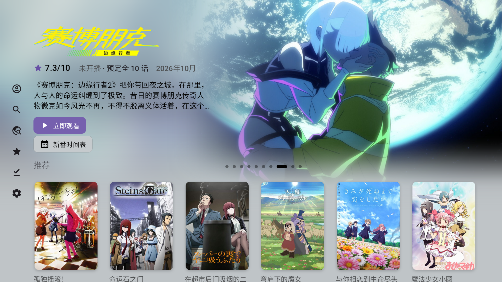 | 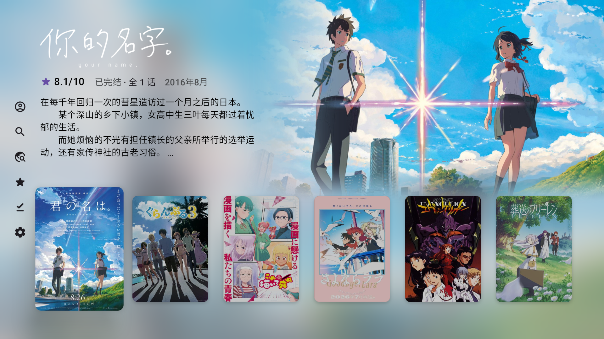 |
|:---:|:---:|
| 首屏是热门动画轮播，下面是推荐 | 在海报上按确认，先显示背景大图和简介 |
| 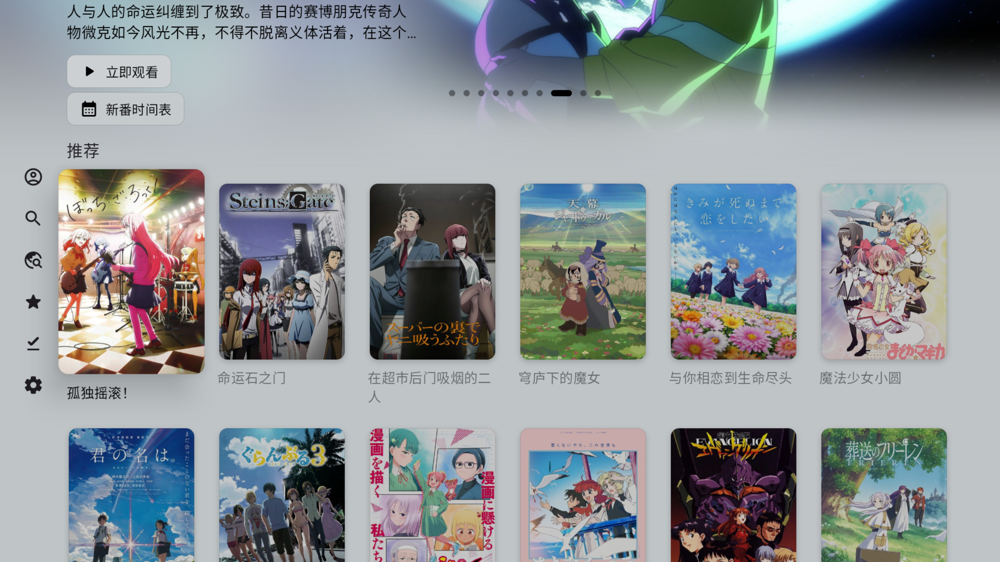 | 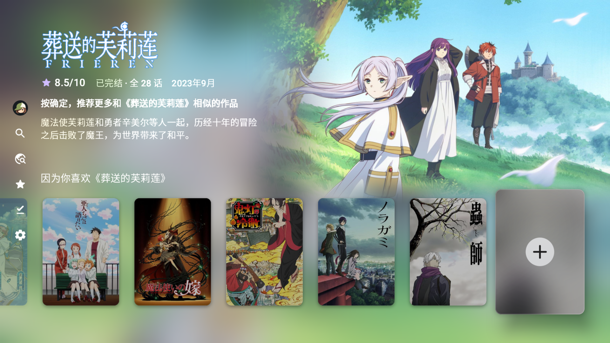 |
|未登录时的推荐区（停手后突出当前卡片） | 「因为你喜欢」推荐行末尾按确认，推荐更多相似的作品 |
| 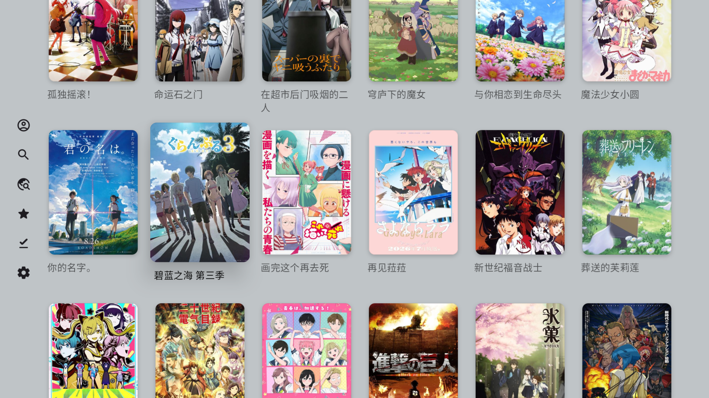 | 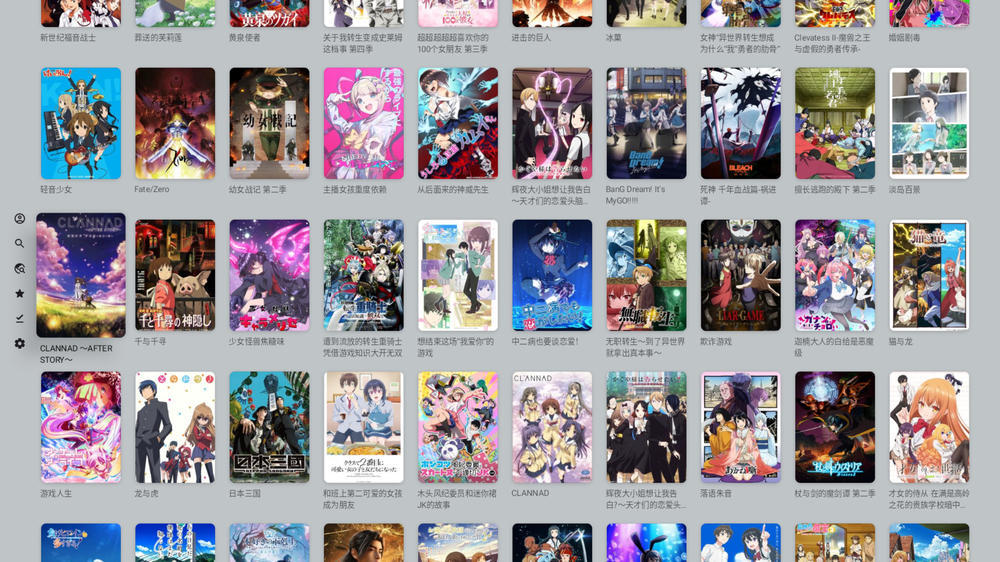 |
| 海报墙 | 「界面缩放」调小后，一屏能放更多海报 |

## 追番页

| 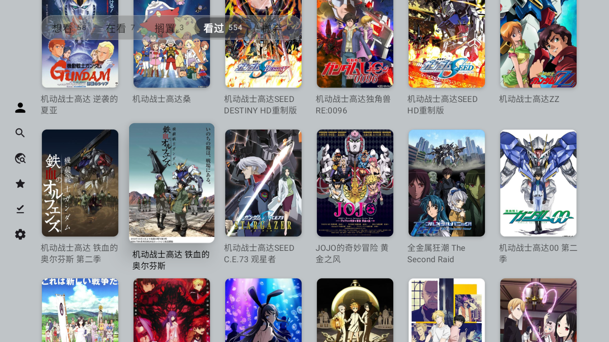 |
|:---:|
| 想看、在看、看过等分类，顺序可以自定义 |

## 搜索页

| 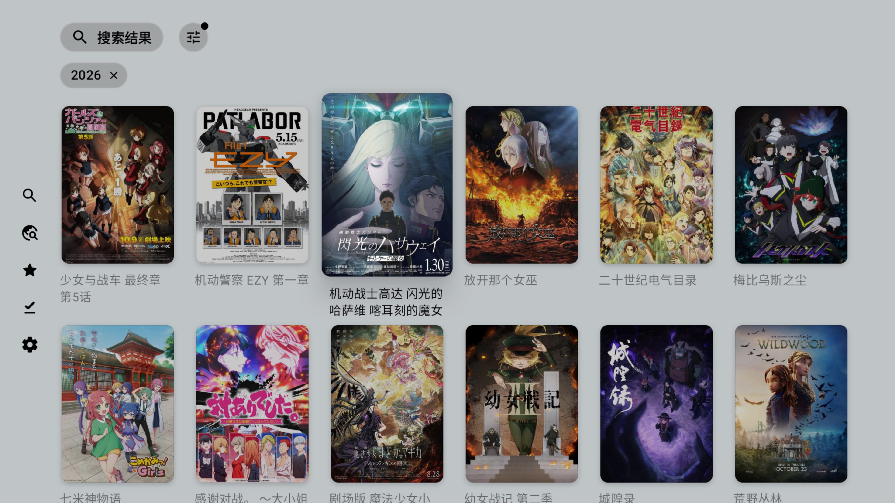 | 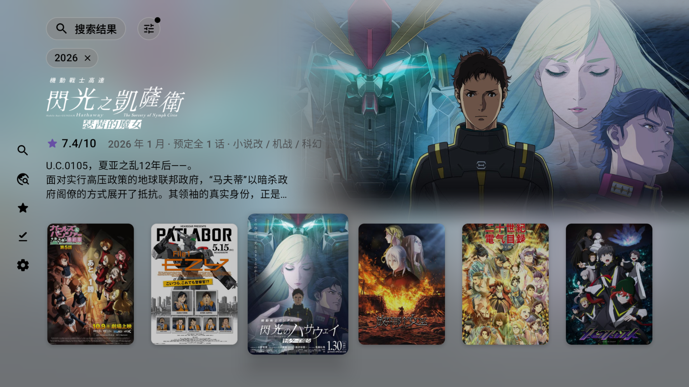 |
|:---:|:---:|
| 按关键词、标签、年份筛选 | 在结果上按确认，先看背景大图和简介 |

## 详情页

| 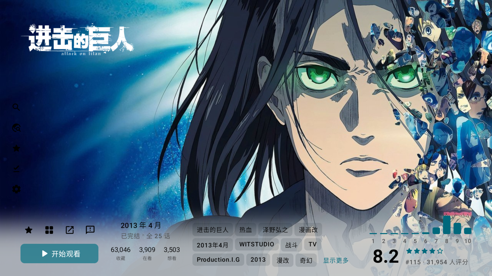 | 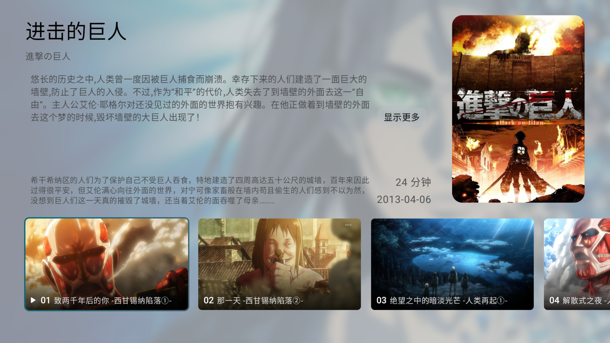 |
|:---:|:---:|
| 评分、标签与收藏人数 | 分集剧照与剧情简介 |
|  | 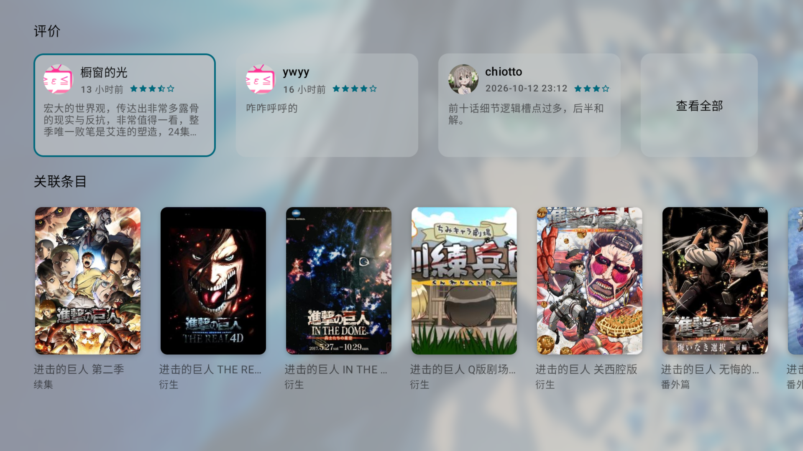 |
| 角色与制作人员 | Bangumi 评价与关联条目 |

## Web 控制台

| 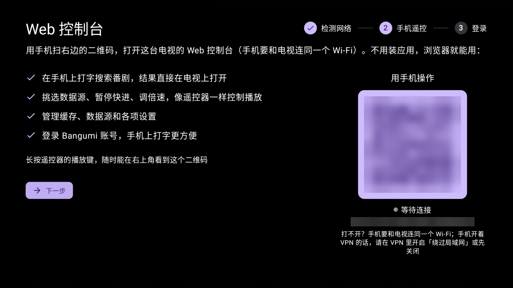 |
|:---:|
| 手机扫码打开，不用装应用：打字搜索、控制播放、管理缓存和设置、登录 Bangumi |

## 播放器

https://github.com/user-attachments/assets/7f9fe051-a904-4157-a317-b13284390fec

## 主屏幕频道与屏保

| 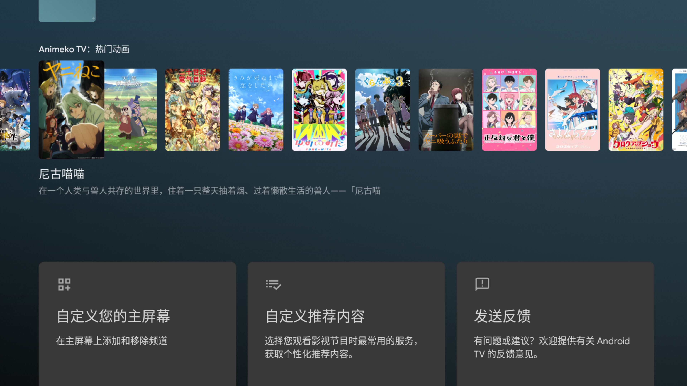 |  |
|:---:|:---:|
| 主屏幕上的「热门动画」频道和「继续观看」行，点卡片直达详情页（首次启动时按系统提示允许添加频道） | 屏保轮播在看和热门动画的剧照，按确认键进入详情页（在系统设置 → 屏保中选择 Izuko TV） |
