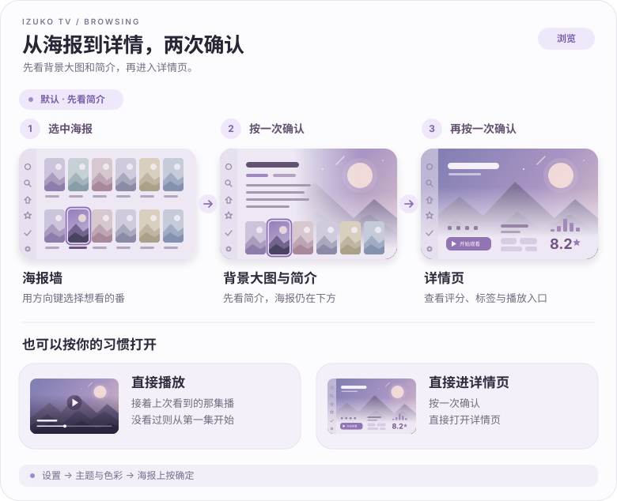
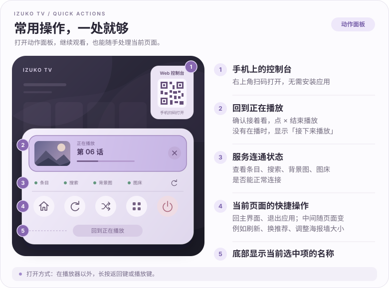
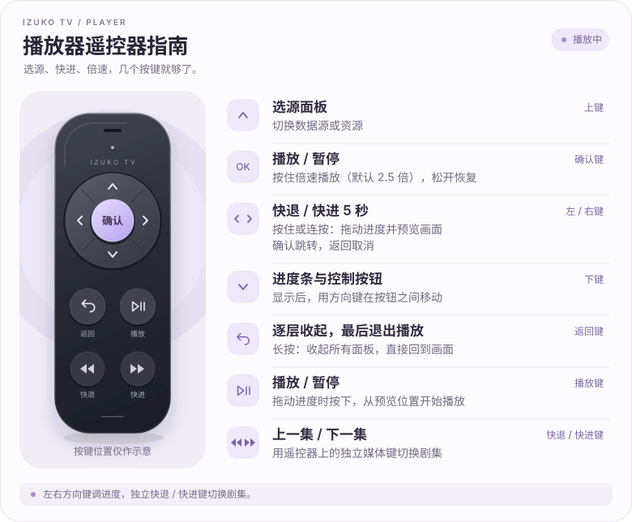

# 使用说明

[← 返回首页](../../README.md)

从海报浏览到播放控制，常用操作都可以用遥控器完成。

## 浏览

探索、搜索、追番和新番时间表中的海报，都支持下面几种打开方式。

首次打开时，也能在引导最后一步「外观与操作」里选择海报的打开方式。

## 动作面板

长按按键的作用可以在「设置 → 界面」里调整。

把缓存移到别的盘、导入收藏或从旧电视搬数据时，面板最上面显示进度；几件事同时在做时，选中那一格按确定看下一个。能停的任务右边有 ✕，按一下就停；搬缓存那条长按会打开「设置 → 存储」查看。

## 播放器

退出播放页后，这一集会保留在后台，能播放时有气泡提示，回来不用重新找源；不需要的话在「设置 → 播放器和弹幕过滤」里关闭。

## 小提示

- **界面太大或太小**：「设置 → 界面 → 界面缩放」可以在 50% ~ 250% 之间调整。
- **电视上登录不方便**：扫登录页上的二维码，在手机上登录。
- **数据源排序**：在「设置 → 数据源管理」长按确认键拿起一行，上下键移动，确认键放下。添加和编辑数据源在 Web 控制台里。
- **网页验证码**（部分在线数据源需要）：用方向键移动页面中间的光标，移到边上会滚动页面，确认键点击；验证通过后一般会自动关闭，没关就长按确认键。
